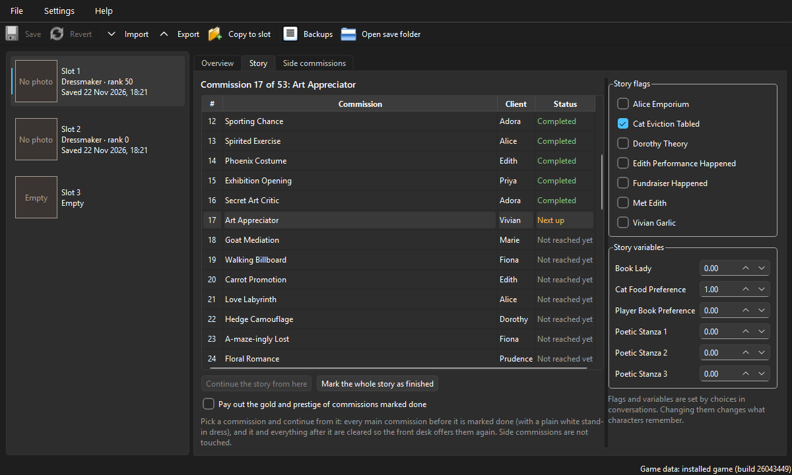

# Dressmaker Save Editor

An unofficial save editor for [Dressmaker](https://store.steampowered.com/app/4019220/Dressmaker/)
by Cozy Lives. It is not affiliated with or endorsed by the developers.



## Download

Get **[DressmakerSaveEditor.exe](https://github.com/nicentra/dressmaker-save-editor/releases/latest/download/DressmakerSaveEditor.exe)**
from the [latest release](https://github.com/nicentra/dressmaker-save-editor/releases/latest)
and double-click it. Nothing to install.

Windows may warn that the app is from an unknown publisher because it isn't
code-signed. Click **More info → Run anyway**. Every release is built by
[GitHub Actions](.github/workflows/release-please.yml) from the code in this
repository.

## What it does

- **Save slots.** See all three of the game's slots with their latest dress photo.
- **Import and export.** Export a slot as a `.zip` (the save plus its dress
  photos) or as the plain `.json`, and import either into any slot.
- **Copy slots.** Duplicate a slot into another one, for example to try
  something out without risking your main game.
- **Story progress.** Continue the main story from any commission: earlier ones
  are marked done, later ones are cleared so the front desk offers them again.
  You can also finish the whole story, and change the story flags and variables
  that conversations set.
- **Replay side commissions.** Clear any side or gift commission so the
  messenger pigeon brings it again, or mark commissions as done.
- **Gold and prestige.** Set them to anything, or jump straight to the top rank.

## Safe by design

The game is strict about its save files: one unknown item, a number in the
wrong format or a quote in your name makes it throw the whole save away and
quietly load the previous one. So the editor:

- **checks every change** the way the game's own loader would before writing,
  and refuses to write anything the game couldn't load;
- **backs up a slot before overwriting it** (Backups… in the toolbar), in its own
  folder so Steam Cloud never syncs them;
- **won't save while Dressmaker is running**, because the game autosaves every
  minute and would overwrite your changes;
- **writes saves exactly the way the game does**, byte for byte, so anything it
  didn't change stays exactly as it was.

Commissions you skip get a plain white stand-in dress, because the game expects
every finished commission to have one. You'll see them in your sketchbook.

## Where things are

| What | Where |
|---|---|
| Your saves | `%USERPROFILE%\AppData\LocalLow\Cozy Lives\Dressmaker` |
| Editor backups, settings, log | `%LOCALAPPDATA%\DressmakerSaveEditor` |

On Linux or Steam Deck (Proton) the saves are inside the game's Proton prefix
under `steamapps/compatdata/4019220/`. The editor looks there too, and you can
always pick the folder in **Settings → Choose save folder…**.

## How it works

The editor reads the list of items, characters and commissions straight from
your installed copy of the game (about two seconds, then cached per game
version), so it keeps up with game updates on its own. If it can't find the
game it falls back to a copy of that data that ships with it.

The save format, and everything the editor has to respect to keep the game
happy, is described in [CONTRIBUTING.md](CONTRIBUTING.md).

## Building from source

You need [uv](https://docs.astral.sh/uv/). Then:

```sh
uv sync
uv run python -m dressmaker_editor           # start the editor
uv run pytest                                 # run the tests
uv sync --group build
uv run python scripts/build_exe.py            # build dist/DressmakerSaveEditor.exe
```

## License

[MIT](LICENSE)
